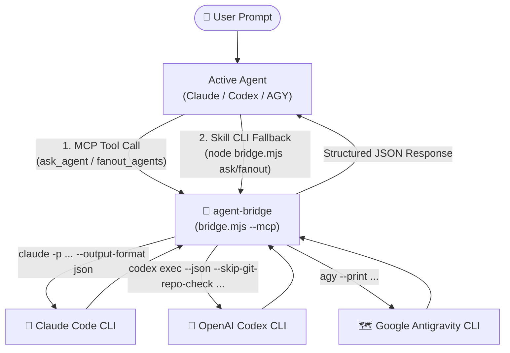

# 🌉 Agent Bridge (`claude` ↔ `codex` ↔ `agy`)

**Zero-dependency MCP Server + Shared Skill + CLI Runner** สำหรับเชื่อมโยงและสั่งงานข้ามกันระหว่าง AI Coding Agents ทั้ง 3 ตัว:
- 🦉 **Claude Code (`claude`)**
- 🔭 **OpenAI Codex (`codex`)**
- 🗺️ **Google Antigravity (`agy`)**

ได้รับแรงบันดาลใจจากแนวคิด **AI Commanding AI (Multi-Agent Orchestration)** โดยออกแบบให้มีไฟล์แกนหลักเพียงไฟล์เดียว (`bridge.mjs`) ที่ใช้เฉพาะ **Node.js Standard Library ล้วน (0 external dependencies)** ทำหน้าที่เป็นทั้ง **MCP Server ตรงกลาง** และ **CLI Tool** พร้อมชุด **Skill (`SKILL.md`)** ที่แชร์ให้ทุก Agent รู้จักวิธีเรียกใช้งานกันและกันโดยอัตโนมัติ

---

## 🏗️ สถาปัตยกรรม (Architecture)



---

## ✨ ฟีเจอร์หลัก (Key Features)

1. **Dual-Mode (MCP Server + CLI ในไฟล์เดียว)**
   - รันด้วย `--mcp` เพื่อเปิดเป็น **Model Context Protocol (MCP) Stdio Server** (รองรับทั้ง Newline-delimited JSON-RPC และ `Content-Length` framing)
   - รันผ่าน Terminal ปกติ (`status`, `ask`, `fanout`, `--self-test`) เพื่อสั่งงานจาก Shell หรือ Script
2. **Parallel Fan-Out (`fanout_agents`)**
   - กระจายโจทย์เดียวกัน หรือแยกโจทย์ย่อย (Subtasks) ให้หลาย Agent ทำงานพร้อมกันแบบขนาน (`Promise.all`) แล้วรวบรวมคำตอบกลับมาเปรียบเทียบ/สังเคราะห์
3. **Safe by Default + Write/Resume Controls**
   - ค่าเริ่มต้นเป็นโหมดปลอดภัย (**Read-only / Sandbox**) ป้องกันไม่ให้หลาย Agent แก้ทับไฟล์เดียวกันโดยไม่ตั้งใจ
   - เปิดโหมดแก้ไขไฟล์ได้เมื่อสั่ง `allow_write: true` (หรือ `--write`)
   - สั่งงานต่อเนื่องจาก Session ล่าสุดของ Agent ตัวนั้นได้ด้วย `resume: true` (หรือ `--resume`)
4. **Recursion Guard & Windows Path Calibration**
   - มีตัวนับ `AGENT_BRIDGE_DEPTH` ป้องกันการเรียก Agent ซ้อนกันเป็นวงจรไม่รู้จบ (Infinite Loop)
   - ค้นหา Binary อัตโนมัติทั้งจาก `PATH` และ Fallback Paths มาตรฐานบน Windows/macOS/Linux แม้รันภายใต้ Sandbox ที่จำกัด Environment Variables

---

## 🚀 การติดตั้ง (Installation)

### ข้อกำหนดเบื้องต้น (Prerequisites)
- **Node.js** `>= 18` (แนะนำ v20/v24+)
- ติดตั้ง CLI อย่างน้อย 2 ตัวขึ้นไปจาก: `claude`, `codex`, `agy`

### ติดตั้งในคำสั่งเดียว (One-Step Setup)

Clone โปรเจกต์ไว้ที่ `~/.agent-bridge` แล้วรันสคริปต์ติดตั้ง:

```bash
git clone https://github.com/Pariman1419/agent-bridge.git ~/.agent-bridge
cd ~/.agent-bridge
node install.mjs
```

สคริปต์ [`install.mjs`](./install.mjs) จะดำเนินการให้อัตโนมัติ:
1. สร้าง Symlink / Windows Junction ของ [`skills/agent-bridge`](./skills/agent-bridge/SKILL.md) ไปยัง:
   - `~/.claude/skills/agent-bridge`
   - `~/.codex/skills/agent-bridge`
   - `~/.agents/skills/agent-bridge`
   - `~/.gemini/config/plugins/agent-bridge/skills/agent-bridge`
2. ลงทะเบียน MCP Server ชื่อ `agent-bridge` เข้าไปใน:
   - `agy mcp add`
   - `codex mcp add`
   - `claude mcp add -s user`

ตรวจสอบความพร้อมหลังติดตั้ง:
```bash
node ~/.agent-bridge/bridge.mjs --self-test
```

---

## 🛠️ เครื่องมือใน MCP Server (MCP Tools Reference)

เมื่อเปิดใช้งานใน Claude, Codex หรือ AGY ตัว Agent จะเห็น 3 เครื่องมือหลัก:

### 1. `ask_agent`
ส่งคำสั่งหรือมอบหมายงานให้ Agent อีกตัวทำงานในโหมด Headless

| Parameter | Type | Required | Description |
|---|---|---|---|
| `agent` | `"claude"` \| `"codex"` \| `"agy"` | ✅ | เลือก Agent เป้าหมาย |
| `prompt` | `string` | ✅ | คำสั่งหรือโจทย์ที่ต้องการมอบหมาย |
| `cwd` | `string` | ❌ | โฟลเดอร์โปรเจกต์เป้าหมาย (ค่าเริ่มต้นคือ working directory ปัจจุบัน) |
| `allow_write` | `boolean` | ❌ | `false` (ค่าเริ่มต้น: อ่านอย่างเดียว) / `true` (อนุญาตให้แก้ไขไฟล์ในโปรเจกต์) |
| `resume` | `boolean` | ❌ | `true` เพื่อสั่งงานต่อจาก Session ล่าสุดของ Agent ตัวนั้น |
| `model` | `string` | ❌ | ระบุชื่อโมเดลเฉพาะกิจ (ถ้าต้องการ override ค่าเริ่มต้น) |

### 2. `fanout_agents`
สั่งงานหลาย Agent พร้อมกันแบบขนาน (`Promise.all`)

| Parameter | Type | Required | Description |
|---|---|---|---|
| `prompt` | `string` | ❌ | คำสั่งกลางที่ต้องการส่งให้ทุก Agent ที่เลือก |
| `agents` | `string[]` | ❌ | รายชื่อ Agent เช่น `["claude", "codex", "agy"]` (ค่าเริ่มต้น `["claude", "codex"]`) |
| `tasks` | `Record<string, string>` | ❌ | แยกคำสั่งเฉพาะเจาะจงรายตัว เช่น `{"claude": "ตรวจ Architecture", "codex": "หา Bug/Race condition"}` |
| `cwd` | `string` | ❌ | โฟลเดอร์โปรเจกต์เป้าหมาย |

### 3. `list_agents`
ตรวจสอบสถานะการติดตั้ง ตำแหน่งไฟล์ `.exe`/binary และเวอร์ชันของ `claude`, `codex`, และ `agy` ในเครื่อง

---

## 💻 การใช้งานผ่าน CLI โดยตรง (Direct CLI Usage)

นอกจากการเรียกผ่าน MCP แล้ว ยังสามารถรัน [`bridge.mjs`](./bridge.mjs) ผ่าน Terminal ได้โดยตรง:

```bash
# 1. เช็กสถานะและเวอร์ชันของ Agent ทั้งหมด
node ~/.agent-bridge/bridge.mjs status

# 2. สั่งงาน Agent ตัวเดียว (Read-only)
node ~/.agent-bridge/bridge.mjs ask codex "Review src/ for potential bugs" --cwd "D:/my-project"
node ~/.agent-bridge/bridge.mjs ask claude "Explain the authentication flow"
node ~/.agent-bridge/bridge.mjs ask agy "Suggest test cases for user service"

# 3. สั่งงานพร้อมอนุญาตให้แก้ไขไฟล์ (--write)
node ~/.agent-bridge/bridge.mjs ask codex "Fix the failing unit test in auth.spec.ts" --cwd "D:/my-project" --write

# 4. สั่งงานต่อเนื่องจาก Session ล่าสุด (--resume)
node ~/.agent-bridge/bridge.mjs ask codex "Now refactor the helper you just touched" --resume --write

# 5. สั่งหลาย Agent พร้อมกัน (Parallel Fan-out)
node ~/.agent-bridge/bridge.mjs fanout "Compare REST vs gRPC for this service" --agents claude,codex
```

---

## 💬 ตัวอย่างการสั่งงานในแชท (Prompt Examples)

คุณสามารถพิมพ์สั่งในหน้าแชทของ **Claude Code**, **Codex**, หรือ **Antigravity** ได้ด้วยภาษาธรรมชาติ เช่น:

- **ขอความเห็นที่สอง (Second Opinion / Cross-Review):**
  > *"ใช้ agent-bridge สั่งให้ codex ช่วยรีวิวโค้ดที่เราเพิ่งเขียนหน่อยว่ามีช่องโหว่หรือ edge case ไหม"*
- **กระจายงานแบบขนาน (Parallel Brainstorming):**
  > *"fanout ถามทั้ง claude และ codex ว่าโครงสร้าง Database แบบไหนเหมาะกับฟีเจอร์นี้มากกว่ากัน แล้วสรุปเปรียบเทียบให้หน่อย"*
- **แบ่งงานกันทำ (Task Delegation):**
  > *"วางแผนโครงสร้าง API ให้หน่อย แล้วสั่ง codex ผ่าน agent-bridge (`allow_write: true`) ให้เขียนชุด unit tests ตามแผนนี้"*

---

## 📁 โครงสร้างไฟล์ (Project Structure)

```text
.agent-bridge/
├── bridge.mjs                    # Core MCP Stdio Server + CLI Runner (0 dependencies)
├── install.mjs                   # Cross-agent installer (links skills + registers MCP)
├── package.json                  # Package metadata & npm scripts
├── README.md                     # Documentation
└── skills/
    └── agent-bridge/
        └── SKILL.md              # Shared skill instructions for Claude, Codex, and AGY
```

---

## 📄 License

MIT License
